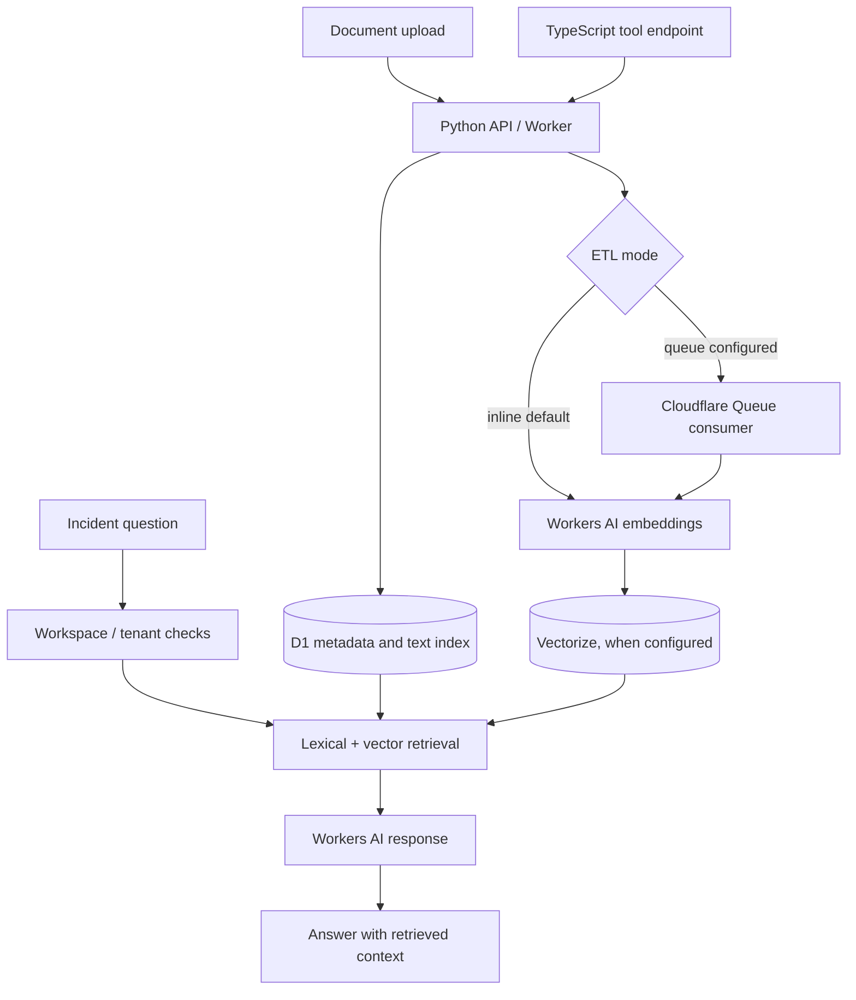

# IncidentIQ — Document-Grounded Incident Triage

IncidentIQ is a backend engineering project for retrieving operational knowledge during incident triage. It combines a Python API, document ingestion, hybrid retrieval, and a TypeScript tool endpoint. The implementation targets Cloudflare Workers and managed data services; repository configuration is not proof of a production deployment.

## At a glance

- **Problem:** incident responders need relevant runbook and document context alongside incident details.
- **Architecture:** FastAPI-compatible Python Worker API, D1 metadata and full-text search, Workers AI embeddings, optional Vectorize, ETL consumer, and a TypeScript MCP-style endpoint.
- **Retrieval:** lexical search and vector search are combined where configured; the code also includes fallback paths.
- **Current evidence:** the PR #2 hosted CI run passes Python tests with coverage, MCP tests and typecheck, dependency audit, Trivy, and the SonarCloud quality gate. The API Worker also starts locally through `pywrangler` and returns 200 from both health endpoints.
- **Readiness:** production readiness is not established. Evaluation fixtures use fake backends; they do not establish live retrieval quality, latency, or cost.

## Architecture and request flow

Uploads persist metadata and document text, then run embedding and indexing in inline mode by default; a queue consumer is available for queue mode. Incident queries retrieve context from the configured lexical and vector stores before generating a response. D1 and Vectorize are separate systems, so partial writes can leave metadata and vectors inconsistent; recovery and reindexing need explicit operational validation.

The TypeScript endpoint exposes tools that call the API. MCP bearer credentials are tenant API keys: the endpoint verifies the key hash against D1, binds the authenticated key to one tenant, and rejects tool arguments that request a different tenant. Calls forwarded to the API use that same tenant key. Tools include writes such as document upload and question/incident operations, so the endpoint is not read-only.

## Design decisions and trade-offs

| Decision | Reasoning | Trade-off / failure case |
|---|---|---|
| Hybrid lexical and vector retrieval | Supports exact terms and semantic matches across operational documents | Ranking and relevance need a representative, live evaluation set; fake-backed harness results do not validate user-facing quality |
| Inline ETL by default, queue mode available | Inline is simpler to run; queue processing can decouple ingestion work | Inline work affects request duration; queue retries, acknowledgement and dead-letter behavior need failure testing |
| D1 metadata plus Vectorize index | Uses managed storage that fits the Workers target | No cross-store transaction; failed embedding/index writes need reconciliation. ETL now reports incomplete embeddings as retry/DLQ work rather than marking the document processed |
| Python API plus separate TypeScript tool adapter | Allows API and tool protocols to evolve independently | Two auth/configuration boundaries increase the chance of inconsistent identity and authorization rules |

## Repository map

- `api/` — Python API, retrieval, ingestion and ETL consumer.
- `mcp/` — TypeScript tool endpoint and its tests.
- `web/` — lightweight browser interface.
- `migrations/` — D1 schema migrations.
- `scripts/` and `docs/` — evaluation and operational material.
- `.github/workflows/` — CI and deployment definitions.

## Evaluation, CI and security

The evaluation material reports a small golden set against fake backends. Treat it as a deterministic harness check, not as measured RAG accuracy, production latency, or a security result. The live smoke harness exercises API behavior but does not establish document-grounded answer quality against a representative corpus.

The GitHub Actions workflow runs Python tests with coverage, MCP type-checking/tests, deterministic evaluation/demo, Python Worker bundle checks through `pywrangler`, and an MCP Wrangler dry run. Ruff runs a strict selected error set without a fallback that could hide failures. The PR #2 hosted CI run passes the dependency audit, Trivy high/critical scan, and SonarCloud quality gate; those checks do not establish deployed Cloudflare security. Sonar analysis fails when `SONAR_HOST_URL` or `SONAR_TOKEN` is absent. A separate manual preview workflow uses distinct D1, Vectorize and queue resources; it refuses IDs/names that match the production configuration. The production workflow requires environment approval and runs authenticated smoke checks after deployment.

## Production readiness

| Area | Evidence in this repository | Assessment |
|---|---|---|
| API and retrieval | Python API, lexical retrieval, Workers AI and optional Vectorize paths | Implemented, but live relevance and failure recovery are unproven |
| Data model | Migrations 001–004 define tenant, document, workspace, incident, triage report, triage metric, token usage, and circuit breaker tables | Triage report persistence is tested; `rag_eval_runs` is schema-only and no live analytics pipeline is established |
| Tenant security | API keys are hashed and workspace roles are checked; MCP validates the API key and binds the tenant before tool calls | End-to-end authorization still needs live multi-tenant testing and an independent security review |
| Frontend | Lightweight interface calls API functions | Authentication is incomplete in current frontend flows; not evidence of a secure user-facing product |
| CI/deployment | Hosted PR checks pass; preview uses isolated config and production requires approval | No verified preview or production deploy run yet |
| Evaluation | Fake-backed golden cases and live smoke script | No defensible live RAG-quality, performance, reliability or cost figures |

**Conclusion:** production readiness and deployment have not been established. Before presenting this as a production service, complete live tenant-isolation and ETL failure tests, frontend authentication, representative retrieval evaluation, operational monitoring, and a verified isolated preview rollout.

## Local development

Follow the component instructions in `api/`, `mcp/` and `web/`. The API tests and fake-backed evaluation harness are useful for local regression checks. Configure Cloudflare bindings and service credentials locally when exercising Workers AI, Queues or Vectorize; never commit credentials.

## Ownership and interview discussion

This README describes the implementation present in the repository and does not assign individual authorship without project-specific contribution evidence. Interview topics include retrieval fallbacks, consistency between D1 and Vectorize, inline versus queued ETL, tenant principal binding in tool calls, and how to design a representative RAG evaluation set.
