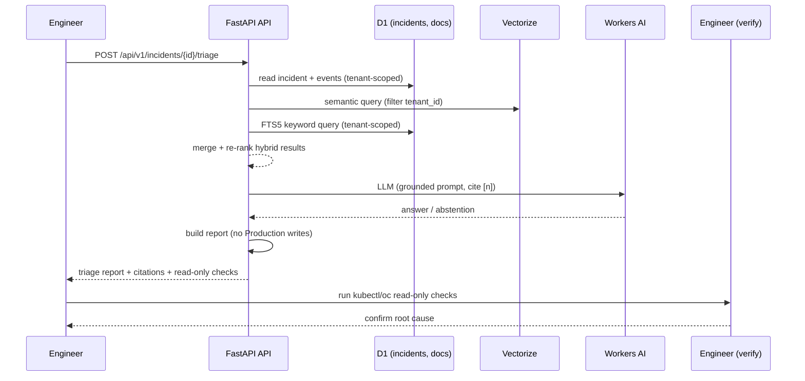

# IncidentIQ — Architecture

## Problem statement
When a Production system fails, a Backend Developer or DevOps Engineer must combine logs, alerts, runbooks, past incidents and technical documentation to find the root cause. That information is scattered, so investigation is slow.

## Solution
IncidentIQ helps engineers investigate incidents by combining logs, alerts, runbooks, incident history and technical docs to propose likely root causes, next read-only checks, and citations. It never mutates Production.

## Users
Backend Developer, DevOps Engineer, SRE Engineer, Technical Lead.

## Stack (Cloudflare Free, $0/month target)

| Layer | Technology | Role |
|---|---|---|
| API | Python FastAPI on Cloudflare Workers (Python 3.13) | REST API `/api/v1`, incident + triage |
| MCP | TypeScript Worker | Remote MCP server: `search_runbooks`, `get_incident`, `find_similar_incidents`, `get_triage_report` |
| Metadata + audit | Cloudflare D1 | Incidents, documents, chunks, workspaces, rate-limit buckets, audit logs |
| Vector search | Cloudflare Vectorize (1024-dim, cosine) | Semantic retrieval over chunks |
| AI inference | Cloudflare Workers AI | Embedding + LLM (model IDs config-driven, not hardcoded) |
| Document storage | D1 (small docs); R2 only if free-tier eligible | Runbooks / postmortems |
| Async processing | Cloudflare Queues + DLQ | ETL chunking/embedding with retry |
| UI | Workers Static Assets (vanilla JS) | Dashboard |
| Monitoring | Cloudflare Observability + AI Gateway | Errors, latency, token/cost |
| Deployment | Wrangler + GitHub Actions | CI dry-run; manual isolated preview deploy |

## Data flow (incident ingestion → triage report)

```mermaid
flowchart TD
    A[Engineer creates incident<br/>POST /api/v1/incidents] --> B[D1: incidents + incident_events]
    B --> C[Triage request<br/>POST /api/v1/incidents/{id}/triage]
    C --> D[Hybrid retrieval<br/>D1 FTS5 keyword + Vectorize semantic]
    D --> E[Build cited context [n]]
    E --> F[Workers AI LLM<br/>grounded answer or abstention]
    F --> G[Triage report<br/>summary, hypotheses, evidence, read-only checks, citations]
    G --> H[Engineer verifies read-only checks<br/>never mutates Production]
    style G fill:#e1f5e1,stroke:#333
    style H fill:#fff9c4,stroke:#333
```

## Sequence diagram (triage)



## Key design decisions
- **No production remediation writes**: triage reads incident and knowledge data but writes its report, audit entry and usage metric to D1. It never restarts a service, deploys, or changes production configuration.
- **Tenant isolation**: API requests derive tenant scope from a validated API key; MCP derives it from the authenticated tenant key and rejects mismatched `tenant_id` arguments. D1 and Vectorize queries are tenant-scoped.
- **Hybrid retrieval**: keyword (D1 FTS5) + semantic (Vectorize), merged and re-ranked. Falls back to keyword-only if Vectorize is down.
- **Abstention**: returns `insufficient_evidence` when no grounding exists; never hallucinates remediation.
- **Idempotency**: `Idempotency-Key` + payload hash on incident creation and document upload.
- **Optimistic concurrency**: `If-Match` / `version` on incident status transitions.
- **Model IDs config-driven**: `WORKERS_AI_EMBED_MODEL` / `WORKERS_AI_LLM_MODEL` (not hardcoded) because Cloudflare rotates models.

## Where the code lives
- `api/src/main.py` — FastAPI routes, triage, hybrid search, middleware (correlation ID, logging, rate limit).
- `api/src/etl.py` — chunking, embedding, Vectorize upsert, retry/DLQ, versioned chunk IDs.
- `mcp/src/index.ts` — MCP server with 4 required tools + auth/rate-limit/audit.
- `migrations/002_incident.sql` — D1 schema (incidents, events, workspaces, FTS5, rate limits).
- `scripts/eval_harness.py` — deterministic golden set against fake backends → `docs/evaluation.md`; not a live retrieval benchmark.
- `docs/adr/` — architecture decision records.
- `docs/interview-defense.md` — ≥25 interview Q&A grounded in code/tests.
